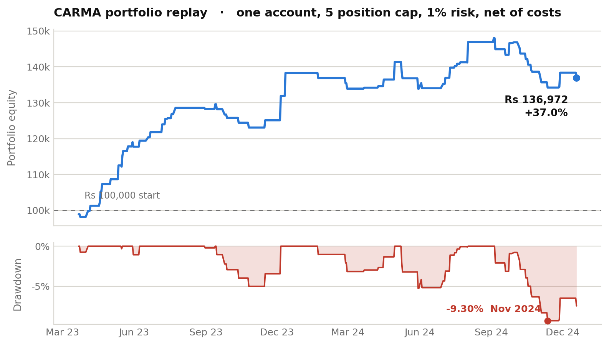

# CARMA, results and audit trail

Out of sample results for CARMA, a multi expert decision engine for NSE equities, with the trade level log behind them and a written record of the defects found while producing them.

The source code is private. Everything needed to judge the results is here.

Figures as of October 2026. They will change as the open items below are closed, and this file is dated so you can tell which version you are reading.

## Test setup

| | |
|---|---|
| Universe | 26 NSE equities, large and mid cap. 23 produced trades. |
| Training | 2018 to 2022 |
| Test | 2023-03-16 to 2024-12-19, 1.76 years. Never used in training. |
| Direction | Long only |
| Costs | 0.05 percent slippage per side plus Rs 20 brokerage per order, charged on notional |
| Sizing | 1R per trade, where 1R is 1 percent of that stock's running equity. Meta model confidence gates entry at 0.75, it does not scale size. |
| Exits | Structural stop from ATR geometry, three stage trail, 25 bar timeout |

## Results

| | Gross | Net, 1x costs | Net, 2x costs |
|---|---|---|---|
| Trades | 113 | 113 | 113 |
| Win rate | 62.8 percent | **61.9 percent** (70/113) | 60.2 percent (68/113) |
| Expected R per trade | +0.453R | **+0.385R** | +0.317R |
| Stocks profitable | 19 of 23 | 19 of 23 | 19 of 23 |

Mean holding period 13.3 bars, median 12, range 1 to 25. Total cost across 113 trades Rs 7,803, being Rs 4,520 brokerage and Rs 3,283 slippage. Cost per trade averages 0.068R, so the edge survives doubling it.

## Portfolio simulation

The backtest runs each stock against its own account, which is not how the strategy would be traded. The 113 trades are replayed below through one shared account at 1 percent risk per trade with a cap of 5 concurrent positions. 86 of the 113 signals are taken. The other 27 fire when the book is full and are dropped.

| | |
|---|---|
| Total return | +36.97 percent over 1.75 years, Rs 100,000 to Rs 136,972 |
| Annualised | +19.73 percent |
| Sharpe | 1.28 monthly. The daily figure is 1.75, but equity realises at trade exit rather than marking open positions to market, which flatters it. The monthly number is the one to use. |
| Max drawdown | 9.30 percent, trough 12 November 2024. Longest stretch underwater 75 business days. |
| Monthly profile | 11 of 21 months positive. Best +10.54 percent, worst 5.59 percent, mean +1.70 percent, standard deviation 4.61 percent. |
| Exposure | At least one position open on 86.3 percent of business days, mean 2.66 concurrent, at the cap on 21 percent of days |

## Two defects found and corrected

An earlier write up of this system reported 148 trades at 67.2 percent and +0.669R. Those numbers are withdrawn. Two defects were found in October 2026 and fixed before anything here was produced.

**Lookahead in the pattern features.** Swing point detection used a window centred on the current bar that extended three bars forward. Nine pattern features derived from it, and those features fed the entry gate. A point in time reconstruction test confirmed the leak: on a sampled stock, 74 of 145 bars had at least one feature change when later bars were withheld. The fix applies a three bar confirmation lag, so a swing at bar t becomes readable only at bar t+3. Detection logic is unchanged. The same test now shows 0 of 145 bars affected. Cost of the fix: win rate 65.4 to 63.2 percent, expected R +0.626 to +0.469 gross.

**Transaction costs were documented but never implemented.** The cost model described above appeared in the write up. No such code existed. It is now applied per trade on notional value. Cost of the fix: +0.469R to +0.385R.

Together the two corrections took the headline from +0.669R to +0.385R.

## What is still wrong

These are open. They are listed because results without their failure modes are not evidence.

1. **Universe selection is undocumented.** The 26 names are hardcoded and no selection rule survives. They look like a present day large and mid cap list applied to a 2023 window, which means survivorship and selection bias. This is the largest hole in the result. Closing it needs point in time index constituents.

2. **No benchmark yet.** Nifty 500 total return and an equal weight hold of the same 26 names over the same window are not computed. The test period was a strong bull market, so the return figure is unanchored until they are, and may well lose to the index.

3. **This is a single holdout split, not walk forward.** Train 2018 to 2022, test 2023 to 2024, one window. Earlier write ups called it walk forward. That was wrong.

4. **The pattern model was trained on unlagged features.** The lag fix was applied to the backtest only, so the model sees inputs whose distribution differs from its training data. These results are a lower bound rather than the true level. Retraining is outstanding.

5. **The portfolio figures are a replay, not a rerun.** The 113 trades were selected by a backtest whose gate saw each stock's own drawdown, not portfolio drawdown. A real portfolio system would be more selective across all names at once, so the trade set would differ. Right order of magnitude, not the exact path.

6. **Partial sentiment contamination.** On a cache miss the sentiment module fetches current headlines. 30 of the 113 trades hit a miss and were scored against 2026 news rather than contemporaneous news.

7. **Fractional share sizing.** Positions size in fractional shares, which NSE does not permit. Flooring to whole shares scales realised risk to 0.976 of intended on average and 0.823 at worst, costing roughly 1.8 percent of total R.

8. **Thin per stock samples.** Several names carry 1 to 3 trades. The aggregate of 113 is the meaningful number. The per stock table shows dispersion, not per name significance.

9. **Out of universe generalisation not retested.** An earlier run on 74 stocks outside this universe produced 60.9 percent and +0.430R, but it predates the lookahead fix and has not been repeated.

## Files

| File | What it is |
|---|---|
| `CARMA_Tearsheet.pdf` | Three page results sheet, with per stock breakdown and sensitivity to costs, position cap and risk per trade |
| `trade_log.csv` | 113 rows, one per trade: symbol, entry and exit date and price, exit reason, bars held, gross R, cost in rupees and in R, net R, net R at 2x costs, risk amount, pnl, running equity, and the three expert probabilities at entry |
| `trade_log.xlsx` | Same data, formatted and filterable |
| `equity_curve.png` | Portfolio equity and drawdown, shown above |

## What is not here

The source code, the trained models, the feature definitions and the entry and exit rules are private. Every figure above recomputes from `trade_log.csv` if you want to check the arithmetic.

Three figures cannot be checked against the log, because they come from runs not included here: the meta model ROC AUC of 0.844 across 503 observations, the single expert comparison of +0.204R across 494 trades at 45.7 percent, and the pre correction runs quoted above. Those rest on my own records.

## Contact

Meet Siroya, meetsiroyaa@gmail.com, [linkedin.com/in/meet-siroya](https://linkedin.com/in/meet-siroya)

Questions and corrections welcome. If you find something wrong in here, I would rather know.
